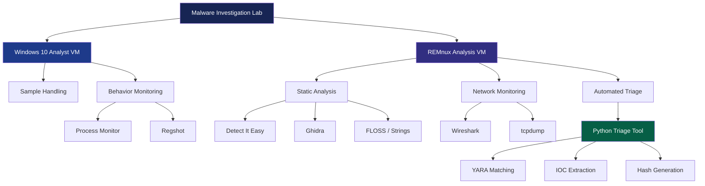
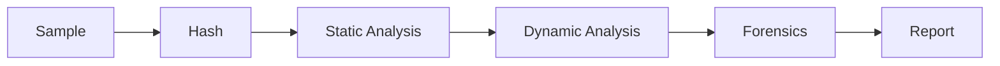
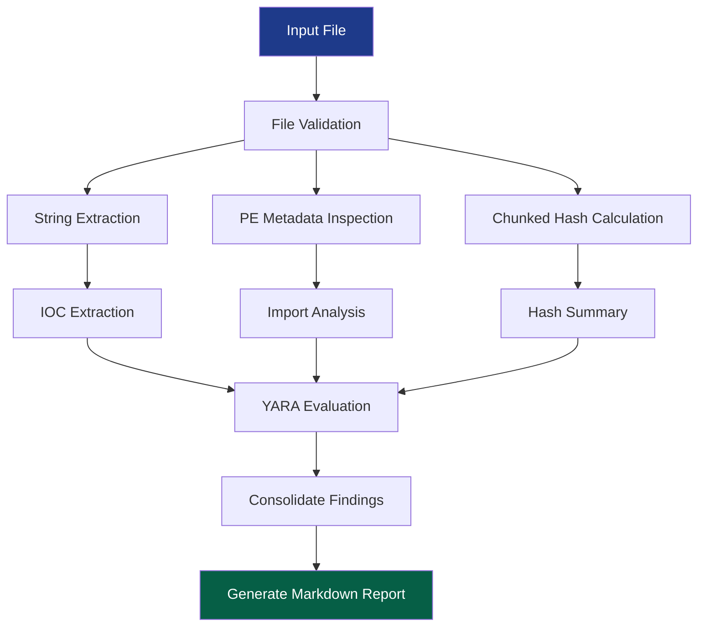

## Malware Analysis & Digital Forensics Lab

### A Practical Malware Investigation, Reverse Engineering & Digital Forensics Environment

<p align="center">
  <strong>Static Analysis · Dynamic Analysis · Reverse Engineering · Memory Forensics · Automated Malware Triage</strong>
</p>

<p align="center">
  <a href="https://www.microsoft.com/en-us/windows">
    
  </a>
  <a href="https://www.python.org/">
    
  </a>
  <a href="https://www.kali.org/">
    
  </a>
  <a href="https://www.sleuthkit.org/autopsy/">
    
  </a>
  
</p>

---

---

## 01. Project Overview

The **Malware Analysis & Digital Forensics Lab** is a cybersecurity investigation environment designed to study suspicious Windows executables through controlled static analysis, dynamic analysis, reverse engineering, and digital forensic examination.

The project combines an isolated malware-analysis environment with automated Python-based triage capabilities and structured forensic documentation.

The primary objective is to understand how malware operates, identify indicators of compromise (IOCs), examine suspicious executable characteristics, investigate system artifacts, and produce reproducible technical reports.

The project uses a Windows analyst virtual machine and a REMnux analysis environment connected through an isolated VirtualBox internal network.

### Core Investigation Areas

| Domain | Investigation Focus |
|---|---|
| Static Analysis | PE metadata, hashes, strings, imports |
| Reverse Engineering | Ghidra-based code examination |
| Dynamic Analysis | Process, registry and network behavior |
| Memory Forensics | Volatility 3 analysis |
| Disk Forensics | Autopsy artifact investigation |
| Threat Detection | YARA rule development |
| Automation | Python malware triage utility |

---

## 02. System Architecture

The investigation environment is designed around an isolated malware-analysis network.



### Lab Network Configuration

| Component | Configuration |
|---|---|
| Analyst VM | Windows 10 |
| Analyst hostname | WIN-ANALYST |
| Analyst IP | 10.10.10.2/24 |
| REMnux IP | 10.10.10.1/24 |
| Network type | VirtualBox Internal Network |
| Network name | malnet |
| Gateway/DNS on analyst VM | 10.10.10.1 |

**Isolation note:** The documented lab uses an internal network. Network containment must be revalidated before any malware execution. The configuration should not be assumed safe solely because the network is internal.

---

## 03. Malware Investigation Workflow

The investigation follows a structured sequence from sample identification to forensic reporting.



### Processing Architecture



### Running the Utility

```bash
# Install required packages as documented by the project
python -m pip install -r requirements.txt

# Run automated triage
python tools/triage.py --file path/to/target.txt --output docs/sample-report.md --yara yara/rules/family.yar

# Run unit tests
pytest tools/tests/test_triage.py -v
```

The triage utility is intended for preliminary analysis. Its output must be reviewed before treating extracted indicators as confirmed findings.

---

## 04. Technology Stack

| Category | Tools |
|---|---|
| Analysis OS | REMnux, Windows 10 |
| Virtualization | Oracle VirtualBox |
| Reverse Engineering | Ghidra |
| PE Analysis | Detect It Easy |
| String Analysis | FLOSS, Strings |
| Network Monitoring | Wireshark, tcpdump |
| Behavioral Monitoring | Process Monitor, Regshot |
| Memory Forensics | Volatility 3 |
| Disk Forensics | Autopsy |
| Detection Engineering | YARA |
| Automation | Python |
| Testing | Pytest |
| Version Control | Git |

---

## 05. Repository Structure

```text
sec04-malware-forensics/
│
├── README.md
├── .gitignore
├── reflection.md
│
├── docs/
│   ├── architecture.md
│   ├── ioc-table.md
│   ├── report.md
│   └── timeline.md
│
├── lab/
│   └── setup-notes.md
│
├── static-analysis/
│   ├── hashes.txt
│   ├── strings-notes.md
│   └── ghidra-notes.md
│
├── dynamic-analysis/
│   ├── findings.md
│   └── screenshots/
│
├── yara/
│   ├── rules/
│   │   └── family.yar
│   └── test-results.md
│
├── forensics/
│   ├── autopsy-findings.md
│   └── volatility-output/
│
└── tools/
    ├── __init__.py
    ├── triage.py
    └── tests/
        └── test_triage.py
```

---

## 06. Testing and Validation

The existing Python test suite reports six successful unit tests using harmless test fixtures.

| Test | Reported Result |
|---|---|
| Hash calculation | PASS |
| String extraction | PASS |
| IOC extraction | PASS |
| Non-PE import handling | PASS |
| YARA matching | PASS |
| Report generation | PASS |

**Reported test execution:** 6 passed.

These results cover the existing unit tests only. They do not establish comprehensive real-world malware detection accuracy or complete end-to-end forensic validation.

Additional validation is required for malformed files, large inputs, edge cases, YARA corpus evaluation and actual forensic evidence.

---

## 07. Evidence and Investigation Status

This project maintains a distinction between collected evidence and pending investigation activities.

| Investigation Area | Current Status |
|---|---|
| Lab network configuration | Evidence available |
| Sample extraction | Evidence available |
| SHA256 identification | Evidence available |
| PE compiler identification | Evidence available |
| MalwareBazaar attribution | Evidence available |
| Python triage unit tests | 6 tests reported passing |
| FLOSS analysis | Pending |
| Ghidra function analysis | Pending |
| Dynamic behavior traces | Pending |
| Autopsy findings | Pending |
| Volatility analysis | Pending |
| Empirical YARA evaluation | Pending |

All future findings must be supported by actual tool outputs, screenshots or reproducible observations.

---

## 08. Security and Evidence Handling

This project follows controlled malware-analysis practices.

- Use only authorized malware samples.
- Maintain an isolated virtual environment.
- Verify network containment before execution.
- Avoid connecting the analysis environment to production networks.
- Do not upload confidential samples or sensitive artifacts to public services.
- Preserve original evidence and calculate hashes.
- Sanitize credentials and sensitive indicators before publication.
- Never commit malware executables, memory dumps, forensic disk images or private keys.

---

## 09. Future Development Roadmap

- [ ] Complete advanced PE analysis.
- [ ] Complete Ghidra reverse engineering documentation.
- [ ] Add verified FLOSS output.
- [ ] Complete isolated dynamic analysis.
- [ ] Add Procmon and Wireshark evidence.
- [ ] Complete Autopsy investigation.
- [ ] Add Volatility 3 memory-analysis results.
- [ ] Expand YARA validation corpus.
- [ ] Expand Python automated triage testing.
- [ ] Add automated evidence indexing.
- [ ] Add CI-based Python testing.
- [ ] Publish a complete investigation walkthrough.

---

## 10. Learning Outcomes

This project is intended to demonstrate practical understanding of:

- Malware analysis methodologies.
- Windows executable internals.
- Reverse engineering fundamentals.
- Threat intelligence and IOC analysis.
- Network behavior investigation.
- Digital forensic evidence handling.
- Memory and disk forensics.
- Python security automation.
- Detection engineering with YARA.

---

## 11. Project Disclaimer

This repository is maintained for educational, research and authorized cybersecurity investigation purposes.

All malware-related experiments must be performed in properly isolated and authorized environments. The presence of a documented workflow does not imply that every investigation stage has been completed or independently verified.

---

<p align="center">
  <strong>Malware Analysis · Reverse Engineering · Digital Forensics</strong>
</p>

---


