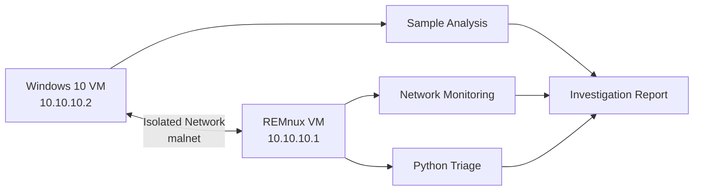
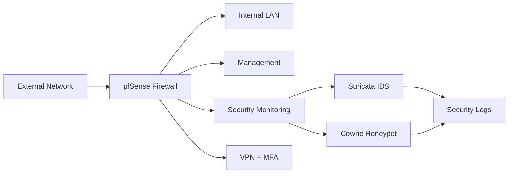

# Cybersecurity Projects Portfolio

**Malware Analysis | Digital Forensics | Zero Trust Network Security**

Two practical cybersecurity projects focused on malware investigation, forensic analysis, network defense, and security monitoring.

---

## Project 01 — Malware Analysis & Digital Forensics

### Overview

A controlled malware analysis lab designed to investigate suspicious Windows executables using static analysis, forensic tools, and automated Python-based triage.

### Lab Architecture



### Tools & Technologies

| Category | Tools |
|---|---|
| Virtualization | VirtualBox |
| Operating Systems | Windows 10, REMnux |
| Static Analysis | Detect It Easy, Ghidra, FLOSS |
| Dynamic Analysis | Procmon, Regshot, Wireshark |
| Forensics | Autopsy, Volatility 3 |
| Detection | YARA |
| Automation | Python, pytest |

### Key Features

- Isolated malware analysis environment.
- SHA256, MD5 and SHA1 hash calculation.
- PE executable inspection.
- ASCII and UTF-16LE string extraction.
- IP address and URL extraction.
- PE import analysis.
- YARA rule matching.
- Automated Markdown report generation.

### Sample Investigation

| Attribute | Finding |
|---|---|
| File type | PE64 executable |
| SHA256 | `92c6da6f9bb94790d24ef471baec6f050fb0304a741f94ef297306eaa3e850a` |
| File size | 660,480 bytes |
| Compiler | MSVC 19.16 |
| Threat intelligence | MalwareBazaar RemcosRAT attribution |

*Threat-intelligence attribution is not independent confirmation of runtime behavior.*

### Testing & Evidence

- Virtual machine configuration and network isolation screenshots available.
- Sample hash and executable identification evidence available.
- Python triage utility implemented.
- Six Python unit tests reported passing.

**Pending:** Detailed Ghidra findings, dynamic analysis logs, memory forensics, disk forensics, and YARA corpus evaluation.

### Repository Structure

```text
sec04-malware-forensics/
├── docs/
├── lab/
├── static-analysis/
├── dynamic-analysis/
├── yara/
├── forensics/
├── tools/
│   ├── triage.py
│   └── tests/
├── README.md
└── reflection.md
```

---

## Project 02 — Zero Trust Network Security

### Overview

A network security project focused on Zero Trust architecture, network segmentation, firewall policies, intrusion detection, secure remote access, and system hardening.

### Network Architecture



*This represents the proposed logical architecture, not a verified deployment.*

### Tools & Technologies

| Category | Tools |
|---|---|
| Firewall | pfSense |
| Intrusion Detection | Suricata |
| VPN | OpenVPN |
| Authentication | MFA |
| System Auditing | Lynis |
| Honeypot | Cowrie |
| Testing | Kali Linux |

### Key Features

- Zero Trust network architecture.
- Network segmentation and access control.
- Firewall rule design.
- Suricata intrusion detection.
- OpenVPN remote-access design with MFA.
- Lynis security auditing.
- Cowrie honeypot monitoring.
- Authorized network security validation.

### Security Validation

| Test | Expected Result |
|---|---|
| Unauthorized network access | Blocked |
| Authorized network access | Allowed by policy |
| Suspicious test traffic | IDS alert |
| Invalid VPN credentials | Rejected |
| Failed MFA verification | Access denied |
| Honeypot interaction | Session recorded |
| System hardening | Changes documented |

### Evidence Status

Project architecture and setup documentation are available.

**Pending verification:** pfSense configuration, Suricata alert logs, VPN/MFA authentication evidence, Lynis reports, Cowrie sessions, and attack-validation results.

### Repository Structure

```text
zero-trust-perimeter-lab/
├── docs/
├── network/
├── ids/
├── vpn/
├── hardening/
├── honeypot/
├── attacks/
├── README.md
└── reflection.md
```

---

## Security & Testing Standards

- Malware samples are handled only in an isolated lab.
- Network testing is restricted to authorized environments.
- Sensitive credentials and malware binaries are excluded from public repositories.
- Findings and metrics are documented only when supported by evidence.
- Planned features are not presented as completed implementations.

## Skills Demonstrated

**Malware Analysis:** Static analysis, PE inspection, IOC extraction, YARA, Python automation.

**Digital Forensics:** Evidence handling, memory and disk forensics workflows, investigation documentation.

**Network Security:** Firewall policies, network segmentation, IDS monitoring, VPN, MFA, system hardening.

---

<p align="center">

**INVESTIGATE • DETECT • ANALYZE • DEFEND**

</p>
