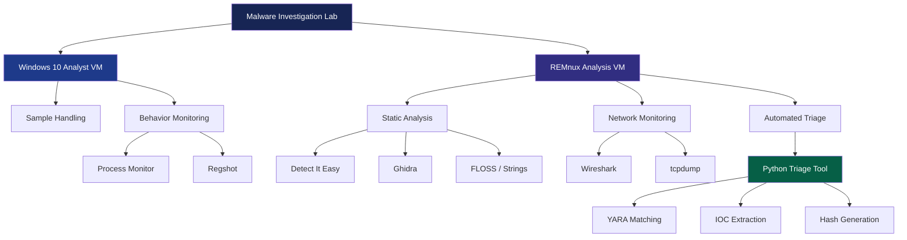
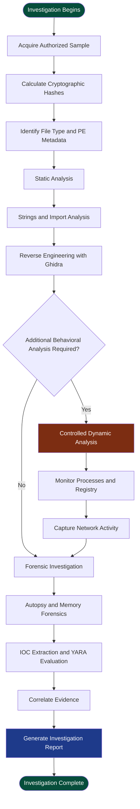
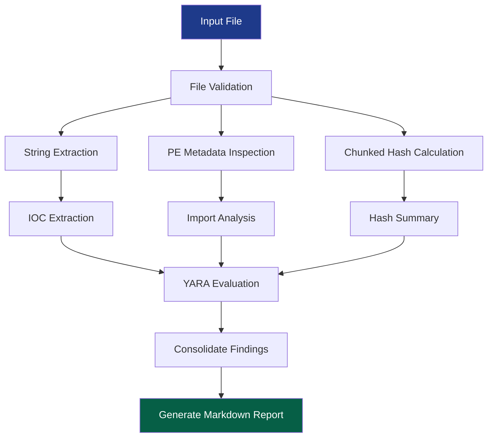
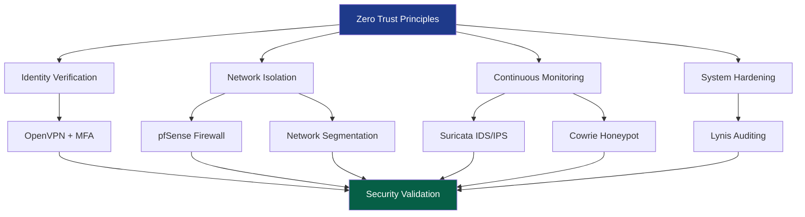
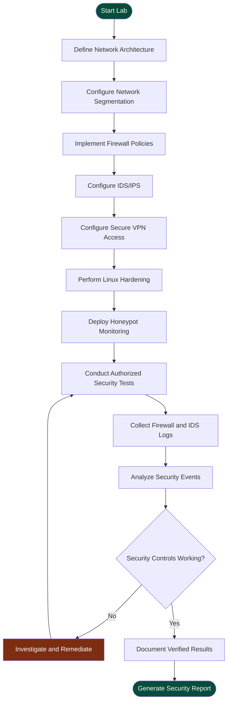
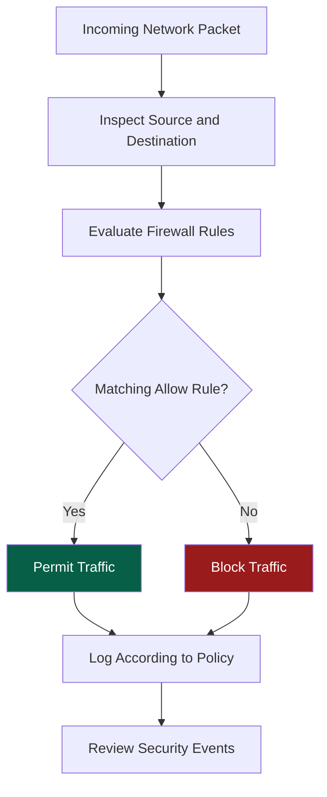
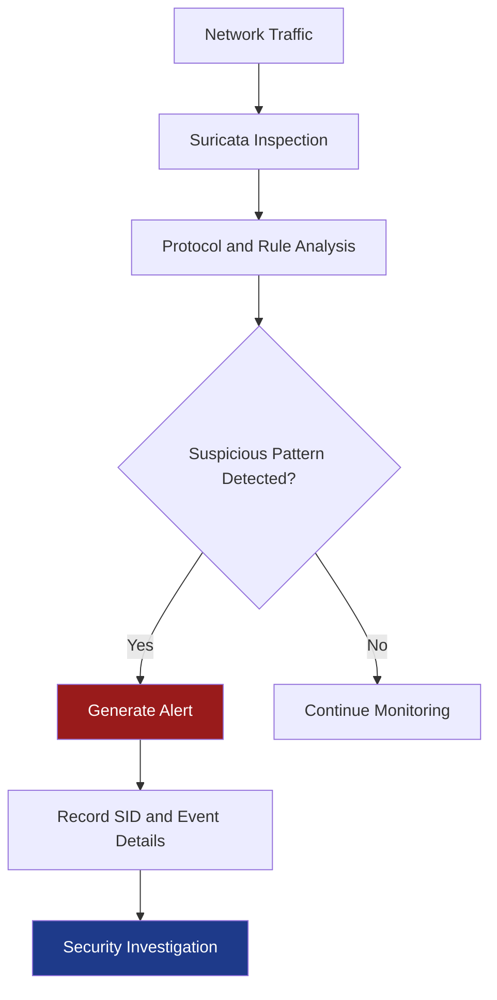
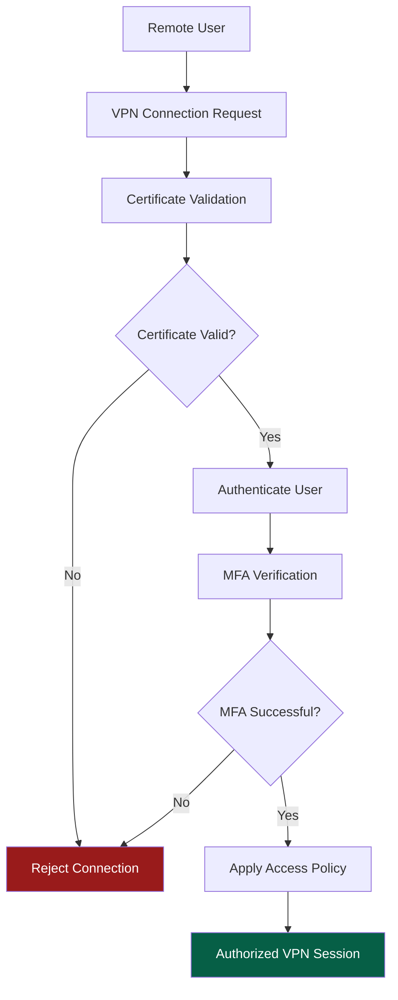
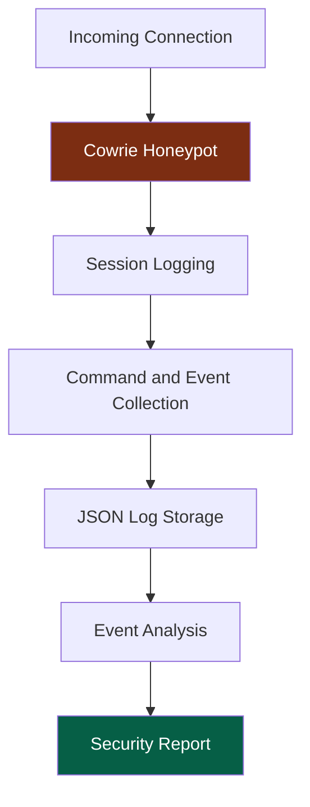

## Malware Analysis & Digital Forensics Lab

### A Practical Malware Investigation, Reverse Engineering & Digital Forensics Environment

<p align="left">
  <strong>Static Analysis · Dynamic Analysis · Reverse Engineering · Memory Forensics · Automated Malware Triage</strong>
</p>

<p align="center">
  <a href="https://www.microsoft.com/en-us/windows">
    
  </a>
  <a href="https://www.python.org/">
    
  </a>
  <a href="https://www.kali.org/">
    
  </a>
  <a href="https://www.sleuthkit.org/autopsy/">
    
  </a>
  
</p>

---

---

## 01. Project Overview

The **Malware Analysis & Digital Forensics Lab** is a cybersecurity investigation environment designed to study suspicious Windows executables through controlled static analysis, dynamic analysis, reverse engineering, and digital forensic examination.

The project combines an isolated malware-analysis environment with automated Python-based triage capabilities and structured forensic documentation.

The primary objective is to understand how malware operates, identify indicators of compromise (IOCs), examine suspicious executable characteristics, investigate system artifacts, and produce reproducible technical reports.

The project uses a Windows analyst virtual machine and a REMnux analysis environment connected through an isolated VirtualBox internal network.

### Core Investigation Areas

| Domain | Investigation Focus |
|---|---|
| Static Analysis | PE metadata, hashes, strings, imports |
| Reverse Engineering | Ghidra-based code examination |
| Dynamic Analysis | Process, registry and network behavior |
| Memory Forensics | Volatility 3 analysis |
| Disk Forensics | Autopsy artifact investigation |
| Threat Detection | YARA rule development |
| Automation | Python malware triage utility |

---

## 02. System Architecture

The investigation environment is designed around an isolated malware-analysis network.



### Lab Network Configuration

| Component | Configuration |
|---|---|
| Analyst VM | Windows 10 |
| Analyst hostname | WIN-ANALYST |
| Analyst IP | 10.10.10.2/24 |
| REMnux IP | 10.10.10.1/24 |
| Network type | VirtualBox Internal Network |
| Network name | malnet |
| Gateway/DNS on analyst VM | 10.10.10.1 |

**Isolation note:** The documented lab uses an internal network. Network containment must be revalidated before any malware execution. The configuration should not be assumed safe solely because the network is internal.

---

## 03. Malware Investigation Workflow

The investigation follows a structured sequence from sample identification to forensic reporting.



### Investigation Stages

**Stage 1 – Sample Identification**

- Obtain an authorized malware sample.
- Extract the sample in the controlled environment.
- Calculate cryptographic hashes.
- Identify executable format and architecture.
- Record sample metadata.

**Stage 2 – Static Analysis**

- Inspect PE headers and sections.
- Identify compiler information.
- Examine imported functions.
- Extract ASCII and Unicode strings.
- Identify suspicious indicators.
- Perform reverse engineering with Ghidra.

**Stage 3 – Dynamic Analysis**

- Execute only inside the verified isolated environment.
- Monitor process creation and termination.
- Identify filesystem modifications.
- Monitor registry modifications.
- Capture DNS and network activity.
- Correlate observed events with static findings.

**Stage 4 – Digital Forensics**

- Examine authorized disk images.
- Identify filesystem artifacts.
- Inspect Prefetch and alternate data streams.
- Examine memory using Volatility 3.
- Maintain evidence provenance and chain of custody.

**Stage 5 – Threat Detection**

- Develop YARA detection rules.
- Validate rules against labelled test samples.
- Identify potential false positives.
- Document verified indicators of compromise.

---

## 04. Automated Malware Triage Utility

A dedicated Python utility is included to automate preliminary malware investigation.

### Capabilities

| Feature | Description |
|---|---|
| Hash Generation | MD5, SHA1 and SHA256 |
| String Extraction | ASCII and UTF-16LE |
| IOC Extraction | IPv4 addresses and URLs |
| PE Analysis | Executable import inspection |
| YARA Integration | Rule-based pattern matching |
| Report Generation | Structured Markdown output |

### Processing Architecture



### Running the Utility

```bash
# Install required packages as documented by the project
python -m pip install -r requirements.txt

# Run automated triage
python tools/triage.py --file path/to/target.txt --output docs/sample-report.md --yara yara/rules/family.yar

# Run unit tests
pytest tools/tests/test_triage.py -v
```

The triage utility is intended for preliminary analysis. Its output must be reviewed before treating extracted indicators as confirmed findings.

---

## 05. Technology Stack

| Category | Tools |
|---|---|
| Analysis OS | REMnux, Windows 10 |
| Virtualization | Oracle VirtualBox |
| Reverse Engineering | Ghidra |
| PE Analysis | Detect It Easy |
| String Analysis | FLOSS, Strings |
| Network Monitoring | Wireshark, tcpdump |
| Behavioral Monitoring | Process Monitor, Regshot |
| Memory Forensics | Volatility 3 |
| Disk Forensics | Autopsy |
| Detection Engineering | YARA |
| Automation | Python |
| Testing | Pytest |
| Version Control | Git |

---

## 06. Repository Structure

```text
sec04-malware-forensics/
│
├── README.md
├── .gitignore
├── reflection.md
│
├── docs/
│   ├── architecture.md
│   ├── ioc-table.md
│   ├── report.md
│   └── timeline.md
│
├── lab/
│   └── setup-notes.md
│
├── static-analysis/
│   ├── hashes.txt
│   ├── strings-notes.md
│   └── ghidra-notes.md
│
├── dynamic-analysis/
│   ├── findings.md
│   └── screenshots/
│
├── yara/
│   ├── rules/
│   │   └── family.yar
│   └── test-results.md
│
├── forensics/
│   ├── autopsy-findings.md
│   └── volatility-output/
│
└── tools/
    ├── __init__.py
    ├── triage.py
    └── tests/
        └── test_triage.py
```

---

## 07. Testing and Validation

The existing Python test suite reports six successful unit tests using harmless test fixtures.

| Test | Reported Result |
|---|---|
| Hash calculation | PASS |
| String extraction | PASS |
| IOC extraction | PASS |
| Non-PE import handling | PASS |
| YARA matching | PASS |
| Report generation | PASS |

**Reported test execution:** 6 passed.

These results cover the existing unit tests only. They do not establish comprehensive real-world malware detection accuracy or complete end-to-end forensic validation.

Additional validation is required for malformed files, large inputs, edge cases, YARA corpus evaluation and actual forensic evidence.

---

## 08. Evidence and Investigation Status

This project maintains a distinction between collected evidence and pending investigation activities.

| Investigation Area | Current Status |
|---|---|
| Lab network configuration | Evidence available |
| Sample extraction | Evidence available |
| SHA256 identification | Evidence available |
| PE compiler identification | Evidence available |
| MalwareBazaar attribution | Evidence available |
| Python triage unit tests | 6 tests reported passing |
| FLOSS analysis | Pending |
| Ghidra function analysis | Pending |
| Dynamic behavior traces | Pending |
| Autopsy findings | Pending |
| Volatility analysis | Pending |
| Empirical YARA evaluation | Pending |

All future findings must be supported by actual tool outputs, screenshots or reproducible observations.

---

## 09. Security and Evidence Handling

This project follows controlled malware-analysis practices.

- Use only authorized malware samples.
- Maintain an isolated virtual environment.
- Verify network containment before execution.
- Avoid connecting the analysis environment to production networks.
- Do not upload confidential samples or sensitive artifacts to public services.
- Preserve original evidence and calculate hashes.
- Sanitize credentials and sensitive indicators before publication.
- Never commit malware executables, memory dumps, forensic disk images or private keys.

---

## 10. Future Development Roadmap

- [ ] Complete advanced PE analysis.
- [ ] Complete Ghidra reverse engineering documentation.
- [ ] Add verified FLOSS output.
- [ ] Complete isolated dynamic analysis.
- [ ] Add Procmon and Wireshark evidence.
- [ ] Complete Autopsy investigation.
- [ ] Add Volatility 3 memory-analysis results.
- [ ] Expand YARA validation corpus.
- [ ] Expand Python automated triage testing.
- [ ] Add automated evidence indexing.
- [ ] Add CI-based Python testing.
- [ ] Publish a complete investigation walkthrough.

---

## 11. Learning Outcomes

This project is intended to demonstrate practical understanding of:

- Malware analysis methodologies.
- Windows executable internals.
- Reverse engineering fundamentals.
- Threat intelligence and IOC analysis.
- Network behavior investigation.
- Digital forensic evidence handling.
- Memory and disk forensics.
- Python security automation.
- Detection engineering with YARA.

---

## 12. Project Disclaimer

This repository is maintained for educational, research and authorized cybersecurity investigation purposes.

All malware-related experiments must be performed in properly isolated and authorized environments. The presence of a documented workflow does not imply that every investigation stage has been completed or independently verified.

---

<p align="center">
  <strong>Malware Analysis · Reverse Engineering · Digital Forensics</strong>

  # 🛡️ Zero Trust Network Security & Perimeter Defense Lab

### Network Segmentation · Firewall Enforcement · IDS/IPS · VPN Security · Linux Hardening

<p align="center">
  <strong>Designing, implementing and validating a layered network security environment</strong>
</p>

<p align="center">
  
  
  
  
  
</p>

---

## 01. Project Overview

The **Zero Trust Network Security & Perimeter Defense Lab** is a cybersecurity infrastructure project designed to explore layered network defense, controlled access, network monitoring, secure remote connectivity and Linux system hardening.

The project follows the principle of **Never Trust, Always Verify**.

Instead of assuming that devices or users inside a network are automatically trustworthy, the proposed architecture emphasizes explicit access policies, least privilege, network segmentation, continuous monitoring and verification.

The lab brings together firewall enforcement, intrusion detection, VPN-based remote access, system auditing and honeypot-based security monitoring.

The objective is to build a reproducible environment for understanding how different defensive security components work together.

---

## 02. Security Architecture

The proposed architecture separates network protection into multiple security layers.

```mermaid
flowchart TB
    A["External Network / Internet"]
    B["Perimeter Firewall - pfSense"]
    C["Network Segmentation"]
    
    A --> B
    B --> C

    C --> D["Trusted LAN"]
    C --> E["Management Network"]
    C --> F["Security Monitoring"]
    C --> G["VPN Access"]

    D --> H["Authorized Internal Systems"]
    E --> I["Administrative Access"]
    F --> J["Suricata IDS/IPS"]
    F --> K["Cowrie Honeypot"]
    G --> L["OpenVPN + MFA"]

    J --> M["Security Alerts"]
    K --> M
    H --> N["Access Policy Enforcement"]
    L --> N

    M --> O["Investigation and Reporting"]
    N --> O

    style A fill:#172554,color:#fff
    style B fill:#7c2d12,color:#fff
    style F fill:#312e81,color:#fff
    style O fill:#065f46,color:#fff
```



**Architecture note:** This is the intended logical security design. Actual interface assignments, network connectivity and deployed controls must be confirmed against lab configuration evidence.

---

## 03. Zero Trust Security Principles

The architecture is based on the following principles:

| Principle | Implementation Objective |
|---|---|
| Verify Explicitly | Authenticate and authorize access |
| Least Privilege | Grant only necessary permissions |
| Assume Breach | Limit lateral movement |
| Network Segmentation | Separate network security zones |
| Continuous Monitoring | Inspect network and system activity |
| Defense in Depth | Combine multiple independent controls |

### Security Control Mapping



---

## 04. Network Security Workflow

The lab follows a layered implementation and verification process.



---

## 05. Core Security Components

### 5.1 pfSense – Firewall and Network Segmentation

**Purpose:** Establish controlled network communication between different security zones.

Key implementation objectives:

- Define WAN and LAN interfaces.
- Establish separate network segments.
- Apply default-deny access policies where appropriate.
- Restrict unnecessary inbound services.
- Permit only explicitly authorized traffic.
- Record firewall decisions.
- Validate permitted and denied communication.

#### Firewall decision workflow



### 5.2 Suricata – Intrusion Detection and Prevention

**Purpose:** Monitor network traffic and identify suspicious activity.

Key implementation objectives:

- Configure the monitoring interface.
- Define the protected network using HOME_NET.
- Configure detection rules.
- Monitor network events.
- Review Eve JSON alert output.
- Tune rules to reduce false positives.
- Validate alerts using authorized test traffic.

#### Detection workflow



**IDS vs IPS**

| IDS | IPS |
|---|---|
| Detects suspicious activity | Can actively block suspicious traffic |
| Primarily monitoring-oriented | Enforcement-oriented |
| Generates security alerts | Generates alerts and may take action |

The actual operating mode must be verified before claiming prevention functionality.

### 5.3 OpenVPN – Secure Remote Access

**Purpose:** Establish authenticated remote connectivity.

Implementation objectives:

- Configure VPN connectivity.
- Manage certificates securely.
- Apply authentication policies.
- Integrate multi-factor authentication.
- Restrict VPN access to authorized resources.
- Review successful and unsuccessful connection attempts.

#### Authentication workflow



### 5.4 Linux Hardening – Lynis

**Purpose:** Audit Linux system security and identify configuration weaknesses.

The hardening workflow consists of:

1. Conduct baseline security audit.
2. Record findings.
3. Prioritize security recommendations.
4. Apply justified configuration changes.
5. Perform another audit.
6. Compare actual results.


No security score improvements should be claimed without actual baseline and post-remediation reports.

### 5.5 Cowrie – Honeypot Monitoring

**Purpose:** Observe and record interactions directed at a controlled decoy SSH/Telnet service.

Investigation objectives:

- Record connection attempts.
- Capture session metadata.
- Observe attempted commands.
- Analyze interaction patterns.
- Preserve JSON event logs.
- Identify suspicious activity.

#### Honeypot monitoring workflow



The honeypot must remain isolated and must not be used to attack or interact with unauthorized external systems.

---

## 06. Technology Stack

| Category | Technology |
|---|---|
| Firewall | pfSense |
| Network IDS/IPS | Suricata |
| VPN | OpenVPN |
| Authentication | MFA |
| Linux Auditing | Lynis |
| Honeypot | Cowrie |
| Network Testing | Kali Linux |
| Packet Analysis | Wireshark |
| Virtualization | VirtualBox |
| Version Control | Git |

---

## 07. Repository Structure

```text
zero-trust-perimeter-lab/
│
├── README.md
├── .gitignore
├── reflection.md
│
├── docs/
│   ├── architecture.md
│   └── report.md
│
├── network/
│   ├── ip-plan.md
│   └── firewall-rules.md
│
├── ids/
│   ├── suricata-setup.md
│   └── alerts-screenshots/
│
├── vpn/
│   └── openvpn-mfa.md
│
├── hardening/
│   ├── changes.md
│   ├── lynis-before.txt
│   └── lynis-after.txt
│
├── honeypot/
│   └── setup-and-captures.md
│
└── attacks/
    └── results-table.md
```

---

## 08. Security Validation Framework

The project uses controlled verification scenarios to evaluate the intended defensive controls.

| Test Scenario | Expected Security Outcome | Evidence Required |
|---|---|---|
| Unauthorized network access | Traffic blocked | Firewall logs |
| Permitted network access | Traffic allowed by policy | Connectivity test |
| Suspicious test traffic | IDS alert generated | Suricata Eve JSON |
| Invalid VPN authentication | Connection rejected | VPN logs |
| Failed MFA | Access denied | Authentication logs |
| Linux security audit | Findings documented | Lynis output |
| Honeypot interaction | Session recorded | Cowrie JSON logs |

Actual test outcomes must be recorded after execution.

### Validation result format

| Field | Description |
|---|---|
| Test ID | Unique test identifier |
| Objective | Security control being evaluated |
| Source | Authorized test machine |
| Destination | Target lab system |
| Expected Result | Intended security behavior |
| Observed Result | Actual result |
| Evidence | Screenshot or log reference |
| Status | PASS / FAIL / NOT TESTED |

---

## 09. Implementation and Evidence Status

The repository currently contains architecture documentation and configuration guidance. The supplied initial evidence inventory did not include raw logs, screenshots or configuration exports for the Zero Trust lab.

| Component | Current Status |
|---|---|
| Network architecture documentation | Created |
| IP addressing plan | Documented |
| Firewall policy documentation | Created |
| Suricata setup documentation | Created |
| OpenVPN and MFA documentation | Created |
| Linux hardening documentation | Created |
| Cowrie honeypot documentation | Created |
| Attack verification matrix | Created |
| pfSense configuration evidence | Pending |
| Suricata alert evidence | Pending |
| VPN authentication evidence | Pending |
| MFA enforcement verification | Pending |
| Lynis baseline and final output | Pending |
| Cowrie interaction logs | Pending |
| Attack and defense measurements | Pending |

**Important:** Documented architecture and implementation procedures must not be confused with verified deployment results.

---

## 10. Security Considerations

- Use authorized virtual machines and test networks only.
- Follow least-privilege access principles.
- Apply default-deny policies where appropriate.
- Keep management interfaces restricted.
- Protect VPN certificates and private keys.
- Never commit credentials or sensitive configurations.
- Sanitize network logs before public publication.
- Isolate honeypot infrastructure.
- Perform security tests only against authorized lab systems.
- Maintain backups before applying firewall or hardening changes.

---

## 11. Future Development Roadmap

- [ ] Complete pfSense deployment verification.
- [ ] Add sanitized firewall rule exports.
- [ ] Validate Suricata alert generation.
- [ ] Document IDS/IPS operating mode.
- [ ] Verify OpenVPN authentication.
- [ ] Verify MFA enforcement.
- [ ] Complete Lynis baseline audit.
- [ ] Complete post-hardening audit.
- [ ] Deploy and validate Cowrie.
- [ ] Collect genuine honeypot session logs.
- [ ] Execute authorized attack and defense scenarios.
- [ ] Add evidence-backed test results.
- [ ] Add topology and monitoring screenshots.
- [ ] Introduce automated configuration and log validation where practical.
- [ ] Publish a complete lab demonstration.

---

## 12. Learning Outcomes

This project is intended to demonstrate practical understanding of:

- Zero Trust security principles.
- Network architecture and segmentation.
- Firewall configuration and access policies.
- Intrusion detection and prevention.
- Secure remote access and MFA.
- Linux system hardening.
- Honeypot deployment and monitoring.
- Network security testing.
- Security event analysis.
- Defensive security documentation.

---

## 13. Project Disclaimer

This project is developed for educational, research and authorized defensive security purposes.

All network testing must be performed within owned or explicitly authorized lab infrastructure. The documentation describes the intended security architecture and workflows; individual controls must be independently validated before being described as operational.

---

<p align="center">
  <strong>Verify Every Access. Monitor Every Layer. Assume Nothing.</strong>
  <br/>
  <sub>Zero Trust · Network Defense · Security Monitoring</sub>
</p>
  <br/>
  <sub>Investigate. Analyze. Correlate. Document.</sub>
</p>
